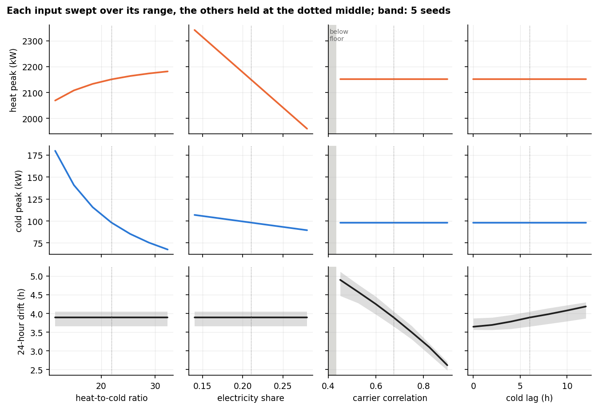
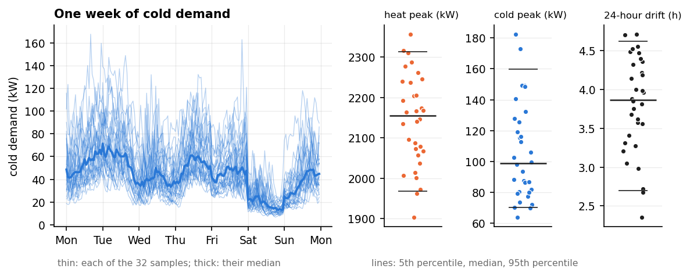
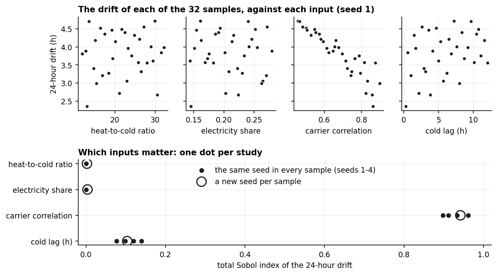

# Sweeps and uncertainty propagation

A metered series gives one demand; `loadcast` gives one per set of inputs, in
about a second. Two kinds of study become cheap: sweeping one input to see what
it does to a design, and sampling uncertain inputs to see what they do to it.
This page runs both on one site. `examples/02_uncertainty.py` runs the sampled
study, and `examples/build_doc_figures.py` draws the figures.

## The example site

The site is a semi-continuous food plant using 10 GWh a year, with four
uncertain inputs:

| input | low | high | from |
|---|---|---|---|
| `heat_to_cold` | 11.5 | 32.3 | food, beverages and tobacco: the two datasets of Rehfeldt et al. disagree by this much (`loadcast.reference.heat_to_cold_range`) |
| `elec_share` | 0.14 | 0.28 | a third either side of JERICHO-E-usage's industry-wide 0.213, which has no sector detail (`loadcast.reference.industry_composition`) |
| `carrier_correlation` | 0.45 | 0.90 | no data: from just above the class's floor to tight coupling |
| cold lag (h) | 0 | 12 | no data: from none to half a day, in whole hours |

A branch's published range does not place a site within it: of three metered
food plants, none fell inside the range for its own branch. These ranges start
a study; widen them when nothing more is known about the site.

Three outputs stand in for those of a design model: the heat and cold peaks,
which size the equipment, and the **24-hour drift** between heat and cold
(`loadcast.integrated_drift`), which is what a store between the two carriers
responds to. Each carrier is divided by its own mean, and the gap between the
two is summed over every 24-hour window; the drift is the mean absolute value
of that sum. Its unit is hours of mean demand: a drift of 3 means that over a
typical day, the two carriers drift apart by three hours' worth of their mean
demand. In a real study, replace these with the outputs of your own design
model.

## One input at a time

Varying one input while holding the others fixed shows what that input does.
Here each input runs over its range while the others stay at the middle of
theirs:

```python
import loadcast

middle = dict(heat_to_cold=21.9, elec_share=0.21, carrier_correlation=0.675,
              cold_lag_h=6)

def drift(heat_to_cold, elec_share, carrier_correlation, cold_lag_h, seed=1):
    profiles = loadcast.generate(
        annual_mwh=10_000, heat_to_cold=heat_to_cold, elec_share=elec_share,
        process_class="semi_continuous", carrier_correlation=carrier_correlation,
        carrier_lag_h={"cold": cold_lag_h}, seed=seed)
    return loadcast.integrated_drift(profiles["heat_kw"], profiles["cold_kw"],
                                     window_h=24)

lag_sweep = {lag: drift(**{**middle, "cold_lag_h": lag}) for lag in range(0, 13, 2)}
```



*Each input swept over its range, the others held at the dotted middle. Each
row shares its scale, so the slopes compare directly. The band spans five
seeds; the peaks have none.*

Each output answers to different inputs. The shares set the peaks: the heat
peak falls from 2341 to 1960 kW as the electricity share rises across its
range, and the cold peak from 180 to 68 kW as the heat-to-cold ratio does. The
coupling between carriers leaves the peaks untouched, because the cap on the
peak holds each carrier at its mean divided by the class's load factor, whatever
the seed. The drift is the reverse: it divides each carrier by its own mean, so
the shares cannot move it, and it answers to the coupling alone. It falls from
4.9 to 2.6 hours as the correlation rises, and grows from 3.7 to 4.2 hours as
the lag does.

The seed band puts these effects in proportion. Five seeds spread the drift by
up to 0.4–0.65 hours: small next to the correlation's effect, but as large as
the lag's. A conclusion about the lag therefore needs several seeds; one about
the correlation does not.

Two rules apply to these sweeps. Hold `carrier_correlation` fixed while
sweeping the lag: it is defined at the offset where the carriers match best, so
the sweep then changes their timing only. And keep the correlation above the
process class's floor, `loadcast.correlation_floor(process_class)` (0.434 for
`semi_continuous`, shaded in the figure). The carriers share a calendar, so
they are correlated at least that much even when their fluctuations are
independent, and no setting delivers less.

## Sampling uncertain inputs

Sampling the four ranges at once gives one year of demand per sample. Sample
the box uniformly, or with a Sobol sequence, which covers it more evenly than
random draws:

```python
from scipy.stats import qmc        # scipy is not a loadcast dependency

low, high = [11.5, 0.14, 0.45, 0.0], [32.3, 0.28, 0.90, 12.0]
samples = qmc.scale(qmc.Sobol(d=4, seed=1).random(32), low, high)

years = []
for heat_to_cold, elec_share, correlation, lag in samples:
    years.append(loadcast.generate(
        annual_mwh=10_000, heat_to_cold=heat_to_cold, elec_share=elec_share,
        process_class="semi_continuous", carrier_correlation=correlation,
        carrier_lag_h={"cold": int(round(lag))}, seed=1))
```

The 32 years take about ten seconds. Each then goes to the design model; here,
to the three outputs:



*Left: the same week in each of the 32 sampled years. Right: each output's 32
values, with lines at the 5th percentile, the median and the 95th percentile.*

| output | P05 | median | P95 |
|---|---|---|---|
| heat peak (kW) | 1967 | 2155 | 2313 |
| cold peak (kW) | 70 | 99 | 160 |
| 24-hour drift (h) | 2.70 | 3.87 | 4.62 |

The cold demand varies mostly in level, set by the heat-to-cold ratio, while
the weekly rhythm of the semi-continuous class stays: high on weekdays, low at
the weekend.

Three cautions apply. **Use the same seed in every sample**, so that the spread
comes from the inputs alone; the next section shows what a new seed per sample
does. **Sample the inputs jointly where you know how they move together**:
drawn independently, they ignore any link between them. And **run one study per
process class**: a class is a category, not a number, and it sets the
correlation floor.

## Which inputs matter

Plotting an output against each input shows roughly which inputs drive it. The
drift of the 32 samples follows the correlation closely and the lag loosely,
and scatters without a trend against the two shares:



*Top: the drift of each sample against each input. Bottom: each input's total
Sobol index, one dot per study: four studies with one seed each, and one with a
new seed in every sample.*

A polynomial chaos expansion puts a number on that ranking. It approximates
each output by a polynomial in the inputs,

$$y(\mathbf x) \approx \sum_{\boldsymbol\alpha \in \mathcal A} c_{\boldsymbol\alpha}\,
\Psi_{\boldsymbol\alpha}(\mathbf x)$$

where $y$ is an output of the design study, such as the capacity of a store;
$\mathbf x$ is the vector of the $M$ inputs; $\Psi_{\boldsymbol\alpha}$ are
polynomials orthogonal for the inputs' distributions (Legendre polynomials for
uniform inputs); $\mathcal A$ is the set of multi-indices $\boldsymbol\alpha$ of
total degree up to 2, which holds $P = (M+1)(M+2)/2$ terms; and
$c_{\boldsymbol\alpha}$ are coefficients fitted by least squares on $n_s$
samples. Take at least twice as many samples as terms: 30 for four inputs, 32
with a Sobol sequence.

The **total Sobol index** of input $i$ follows from the coefficients without
further sampling:

$$\mathcal S_i = \frac{\mathbb E\left[\operatorname{Var}\left(y \mid \mathbf x_{\sim i}\right)\right]}
{\operatorname{Var}(y)}$$

where $\mathbf x_{\sim i}$ is every input except $i$. It is the share of the
output's variance that would vanish if input $i$ were fixed, interactions
included; the indices of all inputs can therefore sum to more than 1.

The **leave-one-out error** says whether the indices can be read:

$$\varepsilon_{\mathrm{LOO}} = \frac{1}{n_s}\sum_{j=1}^{n_s}
\frac{\left(y_j - \hat y_{\sim j}\right)^2}{\operatorname{Var}(y)}$$

where $y_j$ is the output of sample $j$ and $\hat y_{\sim j}$ the expansion's
prediction of it when fitted without it; 0 is a perfect fit, and 1 is no better
than the mean. Print it before reading any index, and read the indices only when
it is small: below 0.2, say.

### The seed

The seed is an input too, but not one a polynomial can follow: two neighbouring
seeds give unrelated years. Changed from sample to sample, it adds a scatter
that the expansion cannot fit and partly attributes to the other inputs. Held
fixed, it leaves the inputs' effect alone, but the result then belongs to that
seed. For the drift of the 32 samples above, with the seed fixed at 1 to 4 and
then changed in every sample:

| seed | $\varepsilon_{\mathrm{LOO}}$ | $\mathcal S$, correlation | $\mathcal S$, lag | $\mathcal S$, heat-to-cold and electricity share |
|---|---|---|---|---|
| 1 | 0.004 | 0.90 | 0.14 | 0.001 each |
| 2 | 0.004 | 0.93 | 0.10 | 0.000 |
| 3 | 0.006 | 0.91 | 0.12 | 0.000 |
| 4 | 0.002 | 0.96 | 0.08 | 0.000 |
| a new one per sample | 0.078 | 0.94 | 0.10 | 0.002 and 0.004 |

The drift divides each carrier by its own mean, so it cannot depend on the
shares, and their indices should be zero. With the seed fixed they are, and the
leave-one-out error is 13 to 34 times smaller. With a new seed per sample, the
error rises and the shares pick up a small false effect. The ranking holds in
every study, but the lag's index moves between 0.08 and 0.14 from one seed to
the next: the spread of the dots in the figure.

So use the same seed in every sample, then repeat the whole study with a few
other seeds, and report the spread of the indices across them. Read the
indices no more finely than that spread.

### Tools

Expansions can be fitted with
[RHEIA](https://github.com/rheia-framework/RHEIA) (Coppitters et al., 2022,
*Journal of Open Source Software* 7, 4370),
[chaospy](https://github.com/jonathf/chaospy) (Feinberg and Langtangen, 2015,
*Journal of Computational Science* 11, 46-57) or
[OpenTURNS](https://openturns.github.io/).

## Nomenclature

| symbol | meaning | unit |
|---|---|---|
| $y$, $\hat y$ | an output of the design study; its prediction by the expansion | that output's |
| $\mathbf x$, $M$ | the vector of uncertain inputs; their number | - |
| $\Psi_{\boldsymbol\alpha}$, $c_{\boldsymbol\alpha}$ | orthogonal polynomials; their coefficients | -, that output's |
| $\mathcal A$, $P$ | the polynomials' multi-indices; their number | - |
| $n_s$ | number of samples | - |
| $\mathcal S_i$ | total Sobol index of input $i$ | - |
| $\varepsilon_{\mathrm{LOO}}$ | leave-one-out error | - |
